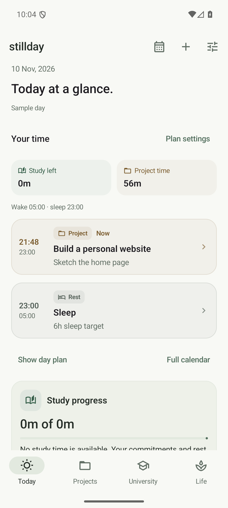
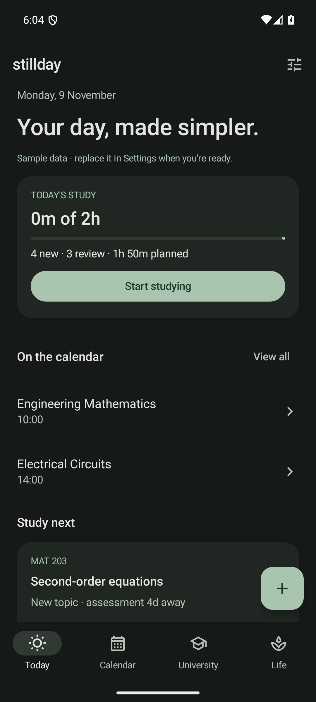
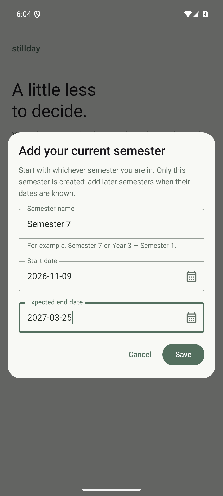

# Stillday

A native, offline Android life planner built around a bounded daily study plan. All application data stays on the device; no account or backend is required.

<p>
  
  
  
</p>

All preview data is synthetic. [GitHub upload instructions](docs/GITHUB_SETUP.md) · [In-app updates and releases](docs/UPDATES.md) · [Day planning and alarms](docs/DAY_PLANNING.md) · [Verification report](docs/TEST_REPORT.md)

## Run it

Clone or extract the source, open the project root in Android Studio, select **JDK 17** for Gradle, and install **Android SDK platform 36** and **Build Tools 36.0.0** in SDK Manager. Android 8.0 / API 26 or newer is required to run the app.

Command-line builds require `JAVA_HOME` pointing to JDK 17 and `ANDROID_HOME` pointing to your Android SDK.

Windows:

```powershell
.\gradlew.bat :domain:test :app:lintDebug :app:assembleDebug
```

Linux/macOS:

```sh
chmod +x gradlew
./gradlew :domain:test :app:lintDebug :app:assembleDebug
```

Optional Windows helpers can download a project-local JDK and create the Pixel 7 emulator profile:

The PowerShell helpers require a policy that permits local scripts. If Windows disables `.ps1` files, use Android Studio or invoke `gradlew.bat` directly with `JAVA_HOME` set to JDK 17 and `ANDROID_HOME` set to the SDK; no system policy change is required to run the Gradle wrapper.

```powershell
.\scripts\Setup.ps1
.\scripts\Build.ps1
.\scripts\Start-Emulator.ps1 -Visible
.\scripts\Build.ps1 -Tasks ':app:installDebug'
```

The installable APK is `app/build/outputs/apk/debug/app-debug.apk`. The debug build is signed with the development machine's Android debug key. Keep that key to install future updates without uninstalling the app.

GitHub Actions runs JVM tests, lint, and the debug build for pushes to `main` and pull requests. Download the resulting APK from the workflow run's artifacts. Use GitHub Releases for distributable APKs instead of adding binaries to Git history. A GitHub-hosted CI run will be verified after the repository is uploaded.

On a phone, transfer the APK, open it, and allow installation from the file manager when Android asks. Add your current semester, such as Semester 3 or Semester 7, with its actual start and expected end date. Only that semester is created. Add subsequent semesters separately when their dates are known; no future semester dates or academic-year offsets are inferred. You can also explore a clearly labeled sample semester and erase it from Settings before entering personal records.

## Features

- Individually created and named semesters with independent start/expected end dates, plus a configurable university timezone.
- Theory/lab courses with independent rooms for each recurring slot, every-N-week recurrence, full-semester generated occurrences, individual rescheduling/cancellation, and attendance.
- Chapters with separate Topics, Exercises, and Example problems sections. Each item has difficulty, understanding feedback, study estimates, partial progress, archive/restore, and independent review history. Problems also track Not started, In progress, and Solved.
- Quizzes and provisional/detailed exams with whole-chapter or individual topic/problem syllabus selection and independent preparation checklists.
- Exam periods that suspend classes and automatically activate an editable focus window. Assignment/project suggestions pause while deadline warnings remain visible.
- Assignments and active/paused personal projects, each with milestones and TODOs. Assignment submission can be marked complete.
- A dedicated Projects main tab with task progress and upcoming milestones; Calendar opens from Today. Back restores the actual previous page, its selected section and scroll position.
- Lab experiments with independent prework/report statuses and submission deadlines, including overdue tracking, Calendar/widget entries and reminders; pending lab work appears on Today.
- [Project-based and experiment-based labs](docs/LABS.md): project-based courses immediately appear in Projects with shared milestones/TODOs, while experiment-based labs retain their prework/report workflow.
- Weekly hall meals, everyday Eat/Skip defaults, weekday exceptions, date-specific overrides, explicit/return travel, location inference, and clearly labeled assumed Monday returns.
- One-off and bounded recurring routines with start/end times or durations, completion, skipping, and individual rescheduling.
- Dynamic study/project time around routines, travel, classes, meals, five manually timed prayers and sleep. Adjustable 50/50 split, ten-minute class buffers, and relaxation gaps under thirty minutes.
- Fajr-based wake-up and bedtime, plus an optional automatic wake alarm with maximum alarm volume, snooze/dismiss controls and a separate Clock backup shortcut.
- A shared, quiet [visual system](docs/UX_SYSTEM.md): violet prayers, sage study, blue classes and amber projects, with icons, time columns, status badges and accessible theme previews. Today previews upcoming activities directly and avoids duplicate event lists.
- Paper, Warm Sand, Charcoal, Midnight, and system themes; accessible form controls and native date/time pickers.
- Home-screen Add Quiz widget, daily briefings, event/deadline reminders, and validated JSON export/import.
- A translucent, theme-matched [home-screen agenda widget](docs/WIDGETS.md), with grouped dates, scrolling/resizing, event links, and quick quiz capture.
- GitHub in-app update checks, verified APK downloads, and Android's installation prompt; daily automatic checks can be disabled in Settings.

## Study policy

See [Exam routines and study choices](docs/EXAMS.md) for per-slot rooms, detailed theory-only exam routines, manual focus controls and today's topic selection. During focus, the next scheduled paper's syllabus guides automatic study; both new topics and preparation reviews remain within the available time and difficult-work limits.

Automatic day planning derives the study budget from remaining free time, shared 50/50 with unfinished active projects by default. Focus reserves all work time for study. When automatic planning is off, fixed budgets default to 120 minutes normally and 360 during exam focus. New learning reserves 30% normally and 20% during focus; remaining time goes to reviews. Empty categories share their unused allocation. Difficulty 4–5 and the latest Again/Hard rating classify a topic as difficult, capped at 40% of the study budget by default. Unused time is not silently filled with more difficult work.

The repetition engine uses an SM-2 adaptation with Again/Hard/Good/Easy feedback. Difficulty seeds the initial ease factor; subsequent understanding ratings adjust it. Each topic maintains independent repetition state. Failed recall restarts at one day, successful reviews expand the interval, and exam preparation adds a separate review opportunity before an assessment. A topic is automatically offered at most once daily. Long sessions are broken into at most 20-minute blocks and retain partial progress. Hard feedback also counts completed work toward the difficult-work allowance.

Course rotation and deferral history spread attention across topics. Missed days never increase the next day's time budget. Completed study remains counted when the plan is recalculated. Manual chapter study and extra practice can exceed the automatic budget because they record work you explicitly chose to do.

Exercises and example problems share the same daily time budget and difficult-work cap as topics. Partial or unsuccessful solve sessions leave a problem In progress; a completed Hard/Good/Easy session marks it Solved. A later failed review changes understanding and the next review date while preserving the historical fact that it was solved. Studying a chapter's concepts does not complete its problems: bulk chapter study selects topics by default, and you explicitly select any exercises/examples you also solved.

This is an explainable planning heuristic, not a guarantee of retention or exam coverage. Plan notes expose deferred work, missing syllabi, and estimated capacity conflicts.

## Data and time rules

Room stores normalized entity tables with stable IDs. Every repository change and backup import validates parent references and business constraints before a database transaction. Settings use DataStore. Backup files are ordinary JSON and include study history and settings; retain a copy outside the phone.

Timetable edits preserve recorded attendance, past occurrences, and explicit exceptions. Exam suppression is calculated from exam periods rather than deleting classes. Unmarked attendance is never treated as absence.

University schedules use the configured university timezone even if the device timezone changes. Travel arrival/departure times use that same configured timezone. Explicit travel overrides assumptions. A one-way home trip infers return on the next Monday, one hour before its first class, or 08:00 without Monday classes. Home meals are flexible, and Other/in-transit meals remain unplanned unless overridden.

Displayed dates use `10 Aug, 2026` consistently, including editable fields, reminders and the agenda widget. Date pickers and typed dates both work; database and backup dates retain their ISO format for compatibility and sorting.

Ordinary reminders use Android inexact idle-aware alarms with periodic WorkManager refresh and boot/time-change recovery. Android battery policies can delay reminder delivery. The optional Fajr wake-up alarm uses AlarmManager alarm-clock scheduling and requires notification permission and Alarms & reminders access on recent Android versions. Its lock-screen UI can require full-screen alarm access. Alarm volume changes affect the phone's shared alarm stream; Android DND and device policies still apply. Location is inferred from travel, without location permission. Internet access is used for GitHub release checks and APK downloads; university and personal records stay on the device. Android's install-from-this-source permission is requested only when installing an update.

## Architecture and tests

- `domain`: serializable entities, recurrence, location/meal resolution, validation, focus calculation, and deterministic study planning. JVM tests include a 150-day, 180-topic simulation with mixed difficulty and missed weeks.
- `app`: Compose screens, Room database, DataStore settings, repository/ViewModel state, native Android home-screen widgets, Android reminders, and instrumented UI/persistence tests.
- Exported Room schemas are under `app/schemas`. Version 1 → 2 adds item type and problem solve status; version 2 → 3 adds lab types and project-course links; version 3 → 4 adds independent experiment submission deadlines; version 4 → 5 adds routine durations/end times, dated meal times and assessment durations; version 5 → 6 adds weekly meal plans; version 6 → 7 adds per-slot rooms and exam-focus overrides. These upgrades retain existing records. Old backups remain importable; retired semester-count/duration settings are ignored. Future schema changes require tested migrations; destructive migration is not enabled.

```powershell
.\scripts\Build.ps1
.\scripts\Build.ps1 -Tasks ':app:connectedDebugAndroidTest'
```

The Pixel 7 emulator profile uses 1080 × 2400 pixels at 420 dpi. See `docs/TEST_REPORT.md` for the actual verification results and limits.

## Repository contents

Source, the Gradle wrapper, Room schema history, tests, and curated screenshots belong in Git. Build output, `.tools`, `.android`, `.gradle`, `.kotlin`, local SDK settings, signing keys, personal backups, and `artifacts/` are ignored. The local APK and verification files remain available on the development machine.
