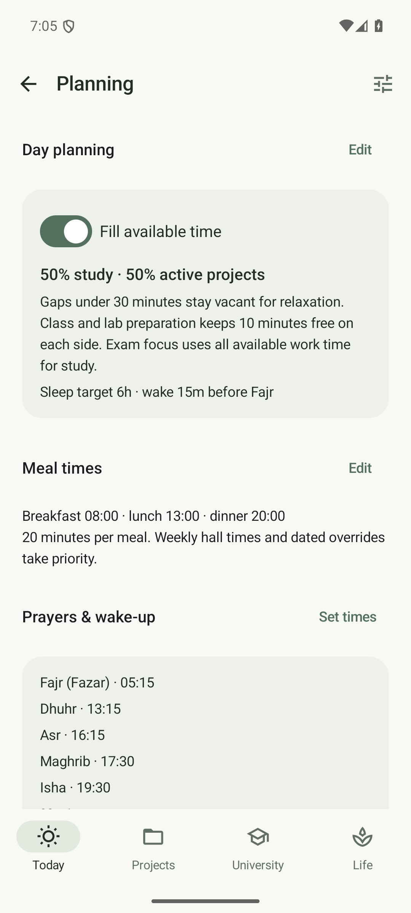
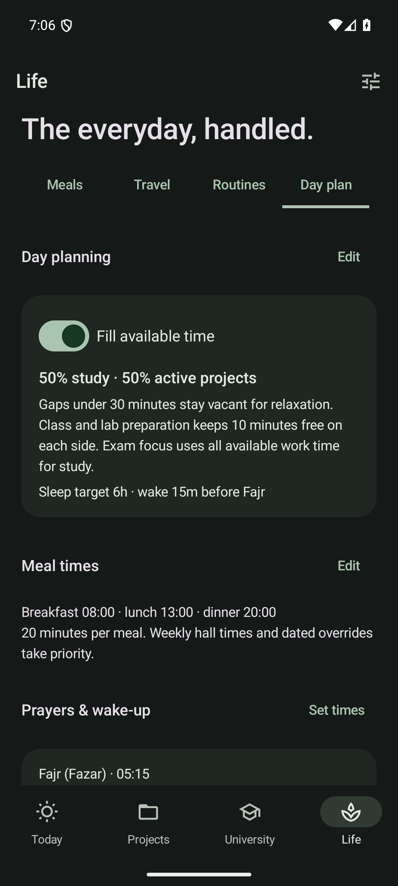
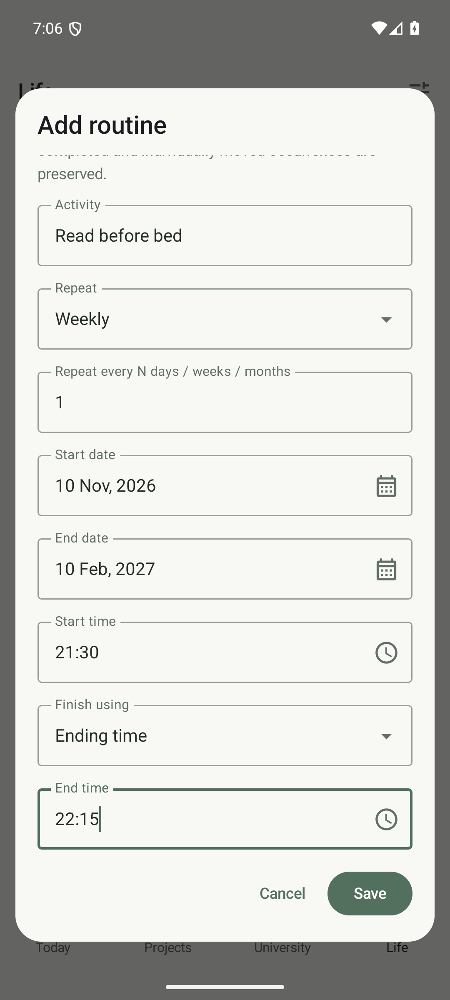

# Day planning, prayer times and wake-up alarms

Open **Life → Day plan**, or **Today → Plan settings**.

  
  
  

## Commitments and available time

- Routines have a start time and either an end time or a duration. An earlier end time finishes on the following day. Use a duration for a 24-hour activity.
- Recurring edits update future unmodified occurrences. Past records, completion history and individual moves retain their own times and durations. Move one occurrence to change just that activity.
- Existing routines migrate with a 30-minute duration. Review these estimates once.
- Classes and labs reserve ten minutes before and after. Cancelled and exam-suppressed classes release their time; rescheduled occurrences reserve their actual new times.
- Travel, assessment durations, meals, prayers and sleep block work time. Deadlines remain reminders rather than artificial calendar appointments.
- Gaps under thirty minutes stay vacant for relaxation. Work blocks are never shorter than thirty minutes.
- Usable gaps default to half study and half active-project work. Edit the percentage in Day planning; whole short blocks can make the result approximate. Paused and fully completed projects receive no time. With no unfinished active project, the time goes to study.
- Exam focus uses all work time for study. Assignment and project TODO suggestions remain paused.
- Each exam period supports Automatic, Start focus and Stop focus. Detailed theory-paper dates prioritize the next paper's syllabus; Today → Choose topics overrides suggestions for that day. See [Exam routines and study choices](EXAMS.md).
- Today shows remaining time. Calendar shows the full day's plan. The agenda widget includes study, projects, meals, prayers and bedtime. The split applies across the whole day; remaining study/project totals can differ as time passes. Work slots keep their start/end times and category as the clock advances, including a partly elapsed current slot. Commitments and preferences trigger recalculation.
- Your topic queue uses the available study allocation, retaining new/review balance, difficult-work limits and ratings. If automatic planning is switched off, your existing fixed daily study budgets apply.
- Conflicting fixed activities are reported without moving them. Sleep remains protected from generated work; a late commitment produces a sleep-conflict warning.

## Choose the work inside a generated slot

Tap a study or project block in Today’s expanded day plan or the full Calendar, then choose **Choose study / project work**. Select individual topics, whole chapters or an active project’s TODO. The slot retains its existing date, start and end; meals, prayer, routines and class buffers remain protected. **Use automatic choice** removes the selection while retaining study history. Future dates can be planned from Calendar. See [manual study and project slots](MANUAL_WORK.md) for details.

## Meals

Set default breakfast, lunch and dinner times and **minutes per meal** under Meal times. The default duration is twenty minutes.

A weekly hall meal's time overrides the default. A dated meal override can set a different time, including when eating outside. A skipped meal releases its time. Travel still determines which meal description applies; home food remains flexible.

Under **Life > Meals**, choose a weekday, then switch off the meal to skip it every week on that day. For example, select Wednesday and switch off Lunch. Other weekdays and meals stay unchanged. Open the meal to edit its menu, time or weekly Eat/Skip plan. A dated override always wins; choose **I will eat as usual** to restore just one date. The former everyday skip setting is removed and ignored when loading old settings or backups. Existing weekday rules are retained. Skipped meals stay marked in the menu and reserve no time in the day plan.

Activity colors and icons are shared across Today, Calendar, University, Projects, Life and the agenda widget. Prayer is violet, study sage, classes blue and projects amber. Today previews its next activities immediately, and expands the remainder on request. See [the visual system](UX_SYSTEM.md).

## Prayers and sleep

Choose **Set times** and manually enter all five times in 24-hour format: Fajr (Fazar), Dhuhr, Asr, Maghrib and Isha. Each prayer reserves five minutes before the entered time to reach the mosque and twenty minutes afterward. For example, a 13:15 prayer occupies 13:10–13:35. The former adjustable prayer duration no longer controls these windows.

Set **Jummah · Friday only** for the Friday congregation. Jummah replaces Dhuhr only on Fridays and uses the same five-before/twenty-after window. If its separate time is blank, Friday Jummah uses your entered Dhuhr time.

The entered times repeat daily until you edit them; this app does not calculate astronomical prayer times.

Wake-up is fifteen minutes before Fajr by default. Bedtime is calculated backward from the following day's wake-up to allow the sleep target, initially six hours. Both values are adjustable. Until prayer times are entered, the manually editable fallback wake time is used. An alarm is never enabled implicitly.

## Automatic wake-up alarm

Enable **Automatic Fajr wake-up** after entering prayer times:

1. Allow Stillday notifications so snooze and dismiss controls are available.
2. On Android 12 and later, allow **Alarms & reminders** using the button shown.
3. Optionally allow the alarm screen on the lock screen on Android 14 and later.
4. Confirm that **Next alarm** displays the expected date and time.

Stillday owns this alarm through Android AlarmManager. It is scheduled while the app is closed, rescheduled after delivery and reboot, and refreshed after app updates and clock/timezone changes. Changing Fajr or the wake offset replaces the pending daily alarm. Switching it off cancels daily and snoozed alarms. Snooze is ten minutes; ringing stops after ten minutes if untouched.

When **Raise alarm volume to maximum** is checked, the alarm service raises the phone's shared alarm stream when it rings. Android's Do Not Disturb, notification settings, fixed-volume devices and managed-device policies still apply. Review your sleep/DND settings to allow alarms. A user force-stop or revoked system permission can prevent alarms until the app is reopened/access restored.

The alarm follows the configured university timezone; its scheduled instant is displayed in that timezone. Check this setting when travelling.

## Clock app

**Create optional Clock backup alarm** opens a compatible Clock app with the calculated wake time and all seven weekdays. **Open Clock** opens its alarm list.

The public Clock API can create an alarm, but cannot reliably replace or disable a repeating alarm when a timetable changes. Dismissing a repeating alarm only skips its next instance. Therefore the automatic alarm is managed by Stillday; Clock backups are separate and must be edited or removed in Clock.

References: [Android AlarmClock API](https://developer.android.com/reference/android/provider/AlarmClock), [alarm scheduling](https://developer.android.com/develop/background-work/services/alarms/schedule), [AudioManager](https://developer.android.com/reference/android/media/AudioManager).
