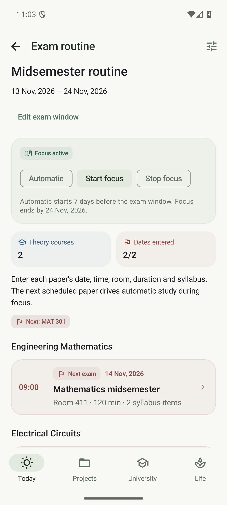
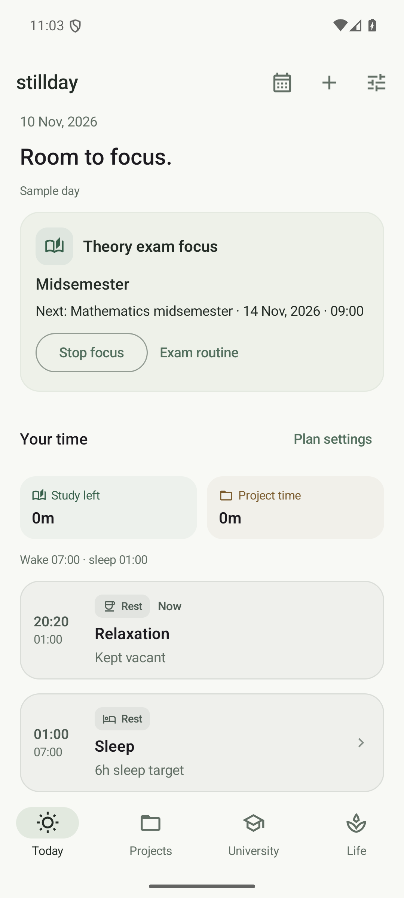
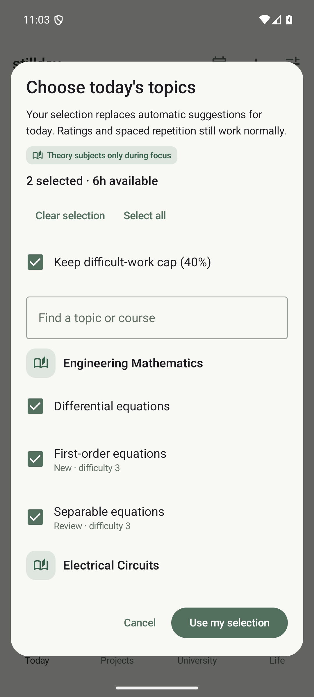

# Class rooms, exam routines and study choices

## Rooms belong to recurring slots

Open **University → semester → course → Schedule → Add slot**. Each slot has its own **Room / location for this slot**. Add a separate slot for each weekly class, with its own room, day, time and recurrence. The course editor no longer assigns a common room.

Changing a recurring slot updates future unmodified occurrences from Apply from date. Recorded attendance, past classes, experiments and individual reschedules stay intact. To change one class only, open that occurrence and use Reschedule this class.

Schema 7 copies the old course room into each existing slot once. Existing occurrence rooms remain unchanged. Old backups receive the same conversion on import; an explicitly blank room in a newer backup stays blank.

## Enter the published exam routine

Open **University → semester → Exam periods → Enter exam routine**. Create the Midsemester or Final window first if necessary.

Only theory courses appear. For each paper, enter its exact date, start time, duration, room and syllabus. Select a whole chapter or individual topics, exercises and example problems. Tap an existing paper to change its routine or syllabus. Dates must fall inside the corresponding exam window. Labs can still have quizzes, but cannot have midsemester/final papers.

  
  

## Start and stop focus

Each exam routine offers **Automatic**, **Start focus** and **Stop focus**:

- Automatic uses the configured lead-in, seven days by default.
- Start focus begins immediately, even before the automatic window.
- Stop focus keeps that period off until you select Automatic or Start focus again.
- Focus expires after the exam window ends, including a manually started period.

Today also offers Start exam focus, Stop focus and a link to the active routine. Stopping from Today stops all currently active periods; stopping one period on its routine screen leaves any other active period alone.

Focus allocates work time to study and pauses assignment, project and lab-work task suggestions. Deadlines remain visible. Classes remain suspended during the exam window independently of focus controls. Projects themselves stay saved and retain their active/paused settings.

## How the next paper controls study

During focus, automatic suggestions use the syllabus of the immediate next theory paper, mixing new learning and preparation reviews. Even a learned topic with a later normal review date can receive an exam-preparation session. When that paper starts, preparation moves to the next paper, using actual times for same-day exams. Simultaneous papers share the queue without duplicating topics.

Before exact dates are known, the planner prepares theory subjects across the active semester. If the next paper has no syllabus, it uses that course's topics and explains the fallback. Difficulty caps, available time and completed work still constrain the queue; a large syllabus does not increase the day's workload.

## Override today's suggestions

On **Today → Choose topics**, clear or change the selection, choose chapters or individual items, then press **Use my selection**. You may choose a different theory paper or review a learned topic that is not due yet. During focus, lab topics remain excluded.

Your choice replaces automatic suggestions for today. The difficult-work cap stays enabled unless you explicitly switch it off in the picker. Available study time always remains a limit, so a large selection may be deferred. Ratings still update spaced repetition normally.

Use **Use automatic plan** to restore suggestions immediately. Otherwise, automatic suggestions return the next day. Already recorded items remain complete for today; use Extra practice in their chapter for another session.

The screenshots use synthetic records on the Pixel 7 emulator.
