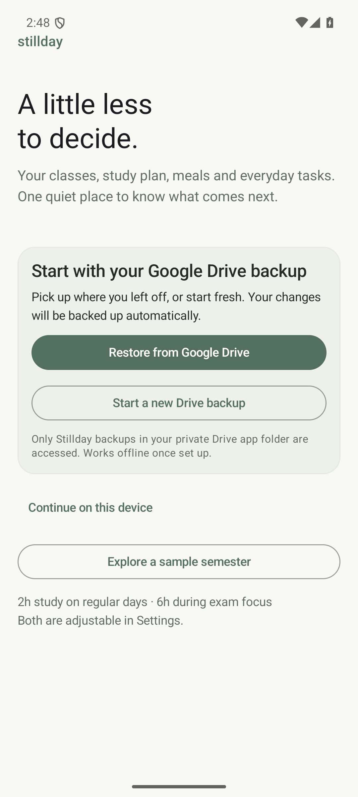
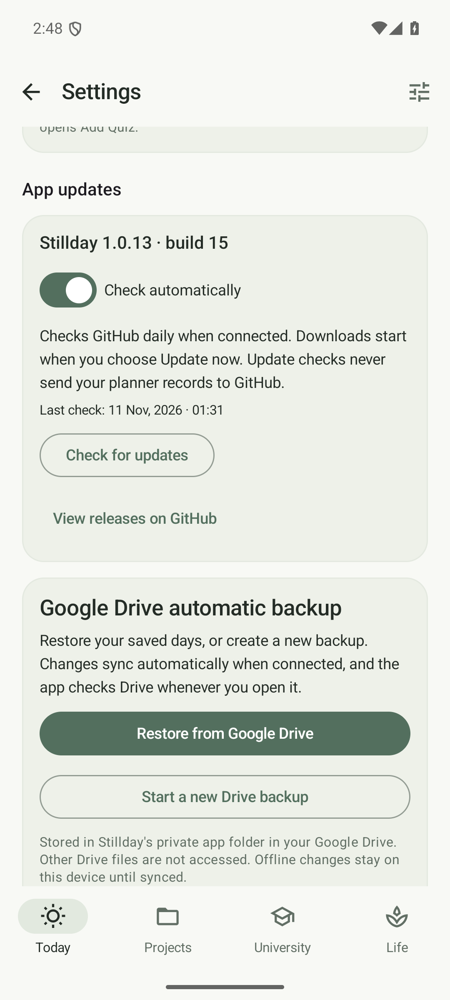

# Google Drive automatic backup

Stillday 1.0.13 / build 15 adds optional Google Drive backup and whole-backup synchronization. The main database remains on the phone and works offline. No backend, API key, Firebase configuration, web client ID or OAuth client secret is embedded in the app.

## First setup

- **Restore from Google Drive**: choose a Google account, grant access, select a Stillday backup, review its contents and choose Restore and sync. The selected file becomes this device's automatic backup.
- **Start a new Drive backup**: choose an account and a backup name. A new file is created from the current data. Add your current semester next; subsequent changes update that same file.
- **Continue on this device** is available when offline or when Google services are unavailable. You can connect from Settings later. Exploring a sample semester disconnects Drive first so sample data cannot replace your real backup.

Backups live in the private appDataFolder of your Google Drive. They do not appear as ordinary My Drive files and cannot be shared with other apps. The restore list shows backups created by this feature under the same Google Cloud project. Existing JSON files saved manually in My Drive can still be imported with Settings > Import backup, then copied to a new automatic Drive backup.

## Automatic behavior

Every change to records or settings queues a backup. Closely spaced edits are combined after a short delay. One waiting job covers any number of offline edits; the app keeps at most one successor to a running job. Opening or returning to the app checks Drive immediately. Once a revision is known, unchanged files require only a metadata check; the full backup is downloaded only when its revision changes. WorkManager also retries when connected and performs periodic recovery checks. Android battery and background restrictions can delay background work.

The last common content fingerprint determines the action; phone clock differences and export timestamps do not decide which copy wins:

| Local copy | Drive copy | Action |
|---|---|---|
| Unchanged | Unchanged | No upload |
| Changed | Unchanged | Update the same Drive file |
| Unchanged | Changed | Validate and restore Drive data |
| Changed | Identical content | Record synchronization without rewriting |
| Changed | Independently changed | Keep both and request a choice |

Conditional If-Match writes prevent a backup downloaded earlier from overwriting a concurrent Drive revision. A local compare-and-set prevents a downloaded backup from replacing records edited during the download. A missing revision tag, invalid JSON, oversized backup or backup written by a newer app stops replacement. The maximum backup size is 20 MB. Room record ordering and export timestamps are excluded from content-change detection.

## Conflicts and recovery

Settings shows **Review both copies** when both devices changed independently. Use Drive replaces the local copy; Keep this device replaces the Drive copy. The dialog compares record counts, and stale decisions are checked again before applying. Both copies are preserved locally before replacement. Up to ten recent distinct safety copies are retained and can be exported with **Export a safety copy**. These safety copies are on this device, not a separate cloud history service.

Imports use a durable recovery journal so interrupted database/settings replacement finishes before later edits are accepted. Google account details, access tokens, file IDs and sync state are device-local and excluded from planner backups. Access tokens are requested from Google when needed and are not saved by Stillday.

**Disconnect Drive** retains both local data and the cloud file. Erasing local data or exploring sample data disconnects automatic backup first. An Android permission or Google consent revocation may require Reconnect Google Drive.

## Check your existing Google Cloud setup

1. Enable the Google Drive API in your Cloud project.
2. Configure the OAuth consent screen and add your Google account as a test user if the project is in testing.
3. Register an Android OAuth client with package **dev.stillday.app** and the **SHA-1 certificate fingerprint of the APK installed on the phone**.
4. Register additional Android clients in that same project for any other signing keys you distribute. Using another project will not expose the first project's private app backups.
5. The authorization scope is **https://www.googleapis.com/auth/drive.appdata**. Stillday does not request access to all of My Drive.

The current laptop development key's SHA-1 is **5D:AC:B5:5B:24:25:E5:28:57:8E:92:E7:4A:8C:35:EC:70:DE:86:47**. The permanent-key draft inspected previously used **A4:D1:01:2A:E9:F3:29:FE:BB:F2:F0:7F:D6:B7:1B:FA:33:A7:59:E5**. Register the fingerprint of the actual distributed APK; these keys cannot update each other's installations in place.

To inspect an APK without Android Studio:

```powershell
$env:JAVA_HOME='E:\Projects\lifestyleApp\.tools\jdk17\jdk-17.0.21+9'
& "$env:LOCALAPPDATA\Android\Sdk\build-tools\36.0.0\apksigner.bat" verify --print-certs 'path\to\Stillday.apk'
```

A Google authorization developer error commonly indicates a package/signature/client configuration mismatch. If no account picker is available, check that Google Play services and a Google account are available on the phone.

## Verification and limits

Automated tests exercise offline recovery, concurrent edits, local and remote writes during synchronization, stale conflict choices, export timestamps, database ordering, conditional HTTP writes, pagination, authorization expiry, malformed or oversized backups and newer-app protection. Device checks exercise onboarding, a cancelled Android account-picker result, local restore compare-and-set, recovery journals and safety copies.

A real Google-account consent/upload/download round trip requires your configured Cloud project and account on the test device. It is separate from the fake-server protocol tests and must not be inferred from them. No real Google account or Drive file was accessed during the automated fixture tests.

<p>
  
  
</p>

Sources: [Android authorization](https://developer.android.com/identity/authorization), [Drive app data storage](https://developers.google.com/workspace/drive/api/guides/appdata), [Drive uploads](https://developers.google.com/workspace/drive/api/guides/manage-uploads).
