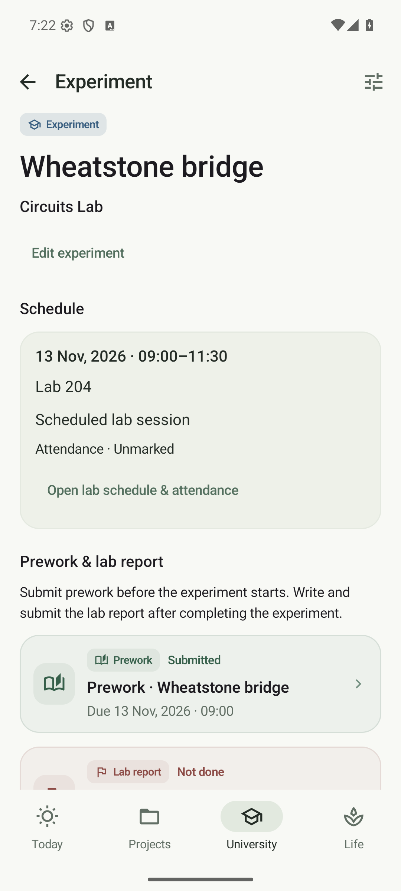
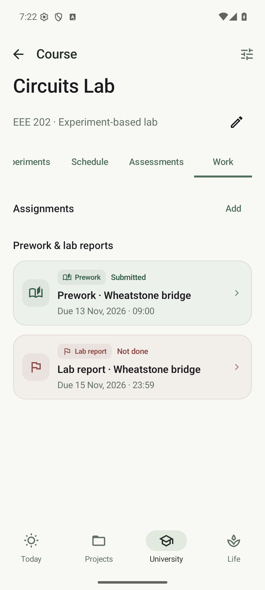

# Project-based and experiment-based labs

In **University → your semester → Add course**, or **Edit course**, choose one of:

- **Theory**
- **Experiment-based lab**
- **Project-based lab**

A project-based lab immediately creates a linked project with the course name and the semester's expected end date. It appears in **Projects** with a lab-course label. Open it to rename it, change its finish date, add milestones and TODOs, or pause its daily activities. The same work is available under **Course → Work → Lab projects**; these are two views of the same records.

You can add further projects from a project-based lab's Work section. **Projects → Add project → Project for** also lets you choose a project-based lab or **Personal project**. A lab project's details link back to its course. Tasks follow the usual active/paused and exam-focus rules; lab-project deadlines appear in Calendar and the agenda widget.

## Experiment-based labs

The course's first tab is **Experiments**, replacing Chapters. Choose **Add experiment**, enter its name and optionally select a generated lab occurrence under **Experiment schedule**. Leave **Not scheduled yet** selected when the routine is not known. You can also add an experiment from an individual lab occurrence as before.

Open an experiment for its date, starting/ending time, room, reschedule/cancellation state and attendance link. Prework and lab report each have their own status and submission deadline. Tap **Edit experiment** or either submission card to update them. Existing statuses remain: Not done, Written, Submitted, Received and Not required.

The course's **Work** tab shows a separate row for every prework and report, including submitted, received and not-required items. Each row includes its deadline when available and current status. Submitted work uses a quiet completed style rather than an overdue warning. Open the row to return to the experiment.

### Before and after the experiment

- Scheduled prework is due **by the experiment's starting time**. Enter a separate earlier deadline when required. If a lab moves earlier, its starting time becomes the latest possible prework deadline; moving later preserves a separately entered earlier deadline.
- Reports follow the experiment. New or edited report deadlines must fall after it ends. Today suggestions and report lead reminders wait until the scheduled end. The Work tab still lists future reports so you can see the whole course.
- Without a schedule, either submission can have an explicitly announced deadline. Otherwise its deadline stays unset. Choose a lab occurrence later to establish the prework cutoff.
- Clearing a prework date removes its explicit earlier deadline; a scheduled experiment still requires prework by its start. Clearing a report date removes its submission deadline.

Dates use `10 Aug, 2026`; times use the configured university timezone. A date with no time defaults to 23:59. For prework on the experiment date, enter an actual time no later than the starting time.

Written work still needs submitting. Submitted, Received and Not required stop warnings and reminders independently. Pending deadlines appear in Today, Calendar and the agenda widget; overdue submissions remain visible. Links open the experiment detail page.

Cancellation and exam suppression do not silently erase explicitly entered deadlines. Without an explicit deadline, a cancelled or suppressed occurrence has no automatic prework cutoff or class-based task suggestion. Review retained explicit dates separately. A reschedule updates the displayed session; existing historical deadlines remain stored, including older dates that would not be accepted for a newly edited schedule.

### Reminders and existing records

Enable reminders and **Prework & lab reports** under [Notification categories & sounds](NOTIFICATIONS.md). Each pending dated submission gets its configured lead reminder and a reminder at its deadline. Report reminders never fire before the scheduled end. Submitting work, disabling the category, or changing a deadline cancels stale alerts, including displayed notifications. Android inexact-alarm and battery policies can delay delivery.

Old experiments retain their statuses, dates, occurrence links and attendance. Database schema **9** adds optional course ownership so new experiments can exist without a schedule; migration fills that ownership from existing occurrences. Backups remain additive and older files are importable. Destructive migration is disabled.

Previous chapters in an experiment-based lab remain accessible under **Previous chapter records**, retaining topics and study history. Changing the course to project-based retains experiments under **Previous experiment submissions** in Work. A project-based course cannot change to another type while projects remain linked: first edit their **Project for** field to make them personal or link them to another project-based lab.

  
  

