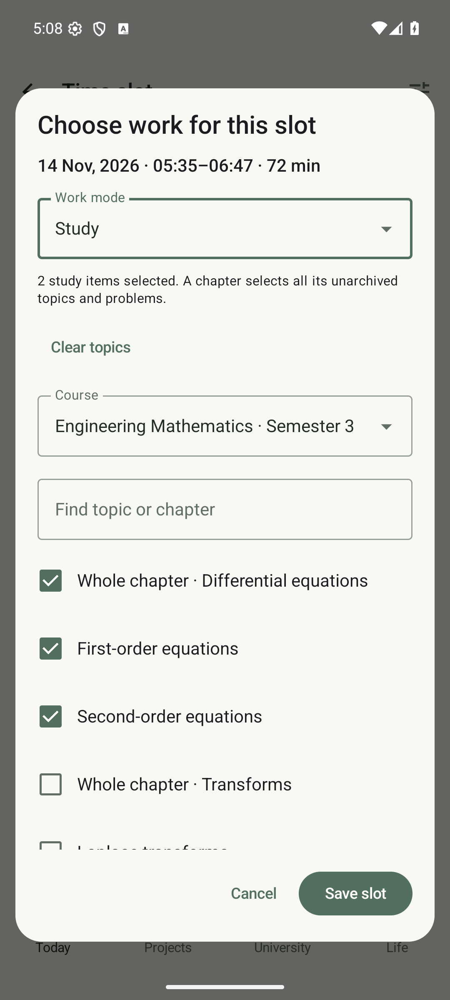
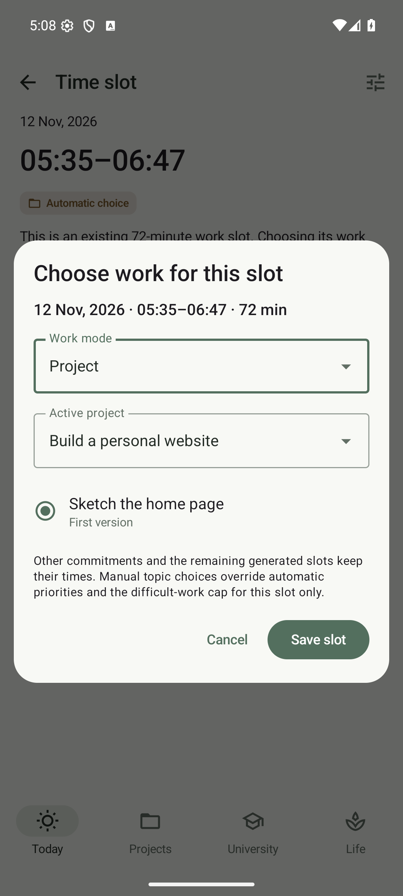
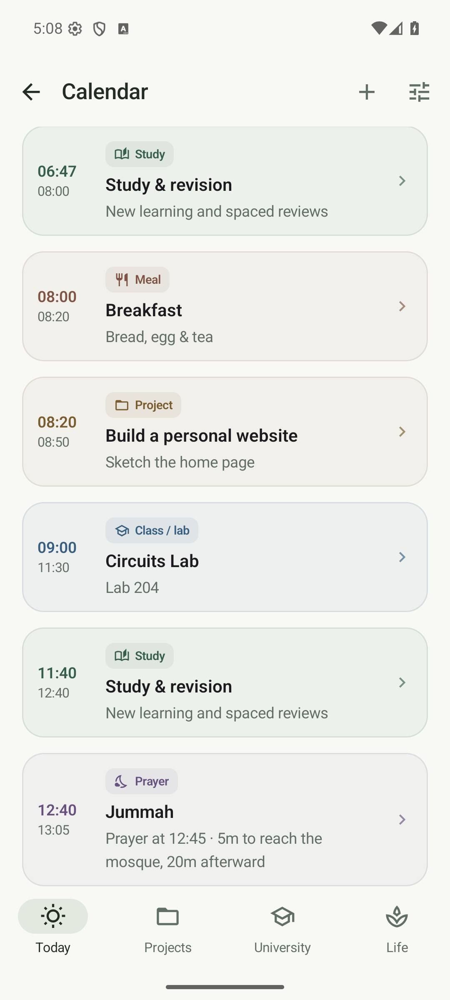

# Manual study and project slots

Stillday generates work slots around meals, prayer, classes, travel, routines and sleep. You can choose the work inside any existing study or project slot without changing its date or times.

## Choose a slot

1. Enable **Fill available time** in Day planning.
2. On Today, expand **Show day plan** and tap a study or project block. For another date, open Calendar from Today, select the date and tap its work block.
3. Tap **Choose study / project work**.
4. Choose **Study** or **Project**, make your selection and tap **Save slot**.

Manual blocks show **Your choice**. Open one again to edit its work, or choose **Use automatic choice** to return it to automatic planning. This keeps recorded study history and completed project tasks.

## Study

Choose a course and select several topics, exercises or example problems. **Whole chapter** selects all its unarchived items. You can combine items from several chapters and courses; switching courses retains your selections. Search filters the visible items.

The selected items share the slot's available time. A large chapter does not create more time or push another activity later. Automatic suggestions elsewhere exclude topics reserved in visible manual study slots. Your explicit choices override automatic topic priorities and the difficult-work cap for that slot; the remaining automatic plan retains its limits.

On the session's date, open it and use **Study this topic** or **Record solve attempt**. Enter actual minutes and understanding/difficulty feedback in the existing study dialogs. Progress and spaced repetition update normally. Each topic can have one recorded result per slot; choosing it in another slot permits another session. Future sessions can be planned but cannot be recorded early. Chapter extra practice remains available for additional attempts.

## Project

Choose an active project and one of its milestone TODOs. This includes project-based labs. Completing the checkbox updates the original task in Projects. Assignment TODOs and paused projects are not offered. A completed chosen task remains visible in its original slot; other automatic slots stop suggesting work for a finished project.

During exam focus, project selections pause and the chooser offers theory study only. Manual topic choices can change the theory syllabus you prioritize inside that slot.

## If your routine changes

Selections belong to a particular generated slot's date, start and end. If a meal, prayer or routine change removes or reshapes it, Stillday warns you and retains the old selection without applying it at a different time. Choose a current Calendar slot again. Clearing or replacing a selection does not erase its historical study records.

Choices and study-history links are included in JSON backups and automatic Drive backups. Older backups import with no manual slot choices. Database schema 8 upgrades existing records without resetting the planner.

## Prayer windows

Enter the actual congregation time. Stillday reserves five minutes before it to reach the mosque and twenty minutes after it. A 13:15 congregation occupies 13:10–13:35.

**Jummah · Friday only** replaces Friday Dhuhr. Set a separate Friday congregation time; leaving it blank uses the Dhuhr time. Other weekdays retain Dhuhr. Wake-up still follows Fajr with the existing adjustable fifteen-minute default offset.

  
  
  

