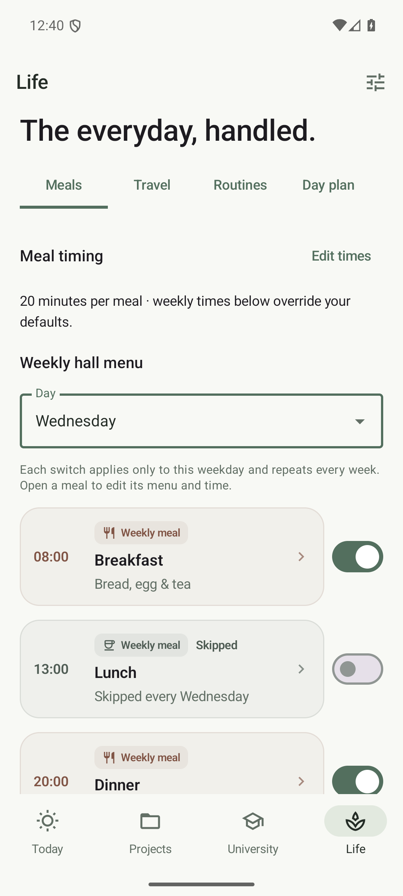
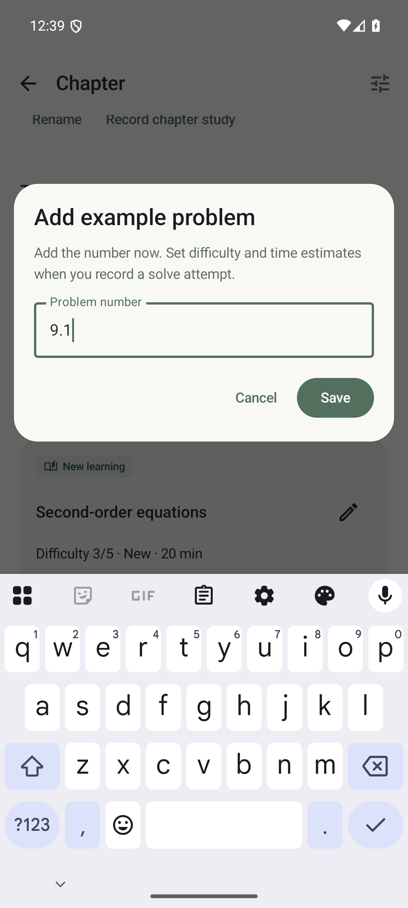
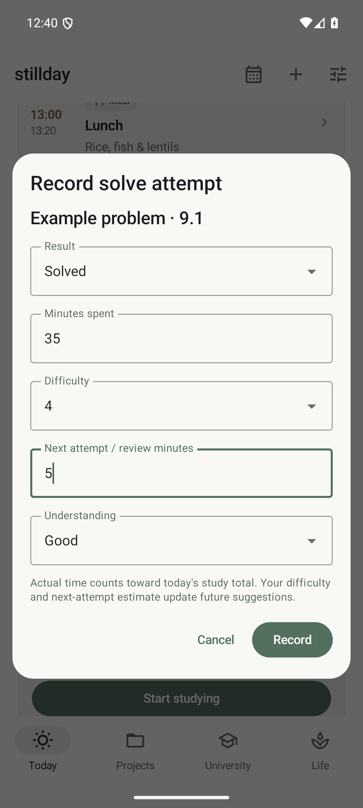

# Weekly meals and problem attempts

## Skip one weekly meal

Open **Life > Meals**, select **Wednesday** in Day, then switch **Lunch** off. This skips lunch every Wednesday only. Each of the 21 weekday/meal combinations has its own rule. Menu editing also offers Eat this weekday and Skip this weekday.

A dated override changes just that occurrence, including restoring a normally skipped meal. Skipped meals do not block study or project time. Travel continues to determine the meal description.

The former everyday skip controls have been removed. Old global skip settings are ignored; saved weekday rules, menus and dated overrides are retained. No database migration or data reset is needed.

## Add exercises and examples

Open a chapter and choose **Add exercise** or **Add example**. Enter only the **Problem number**. The section determines the item type. Renaming a problem preserves its attempt history and estimates.

After attempting it, choose **Record solve attempt** in its chapter, or **Start studying** from Today. Both open the same dialog:

- Result: Solved or Still working.
- Minutes spent: actual time, counted toward the daily study total.
- Difficulty: 1 through 5.
- Next attempt / review minutes: your updated estimate for future suggestions.
- Understanding: Hard, Good or Easy when solved, used for spaced repetition.

An unattempted problem uses a provisional 20-minute estimate so it can appear in the plan without extra setup. Finishing sooner or later records your actual time. Unfinished work keeps its progress and next-attempt estimate. A failed review is scheduled sooner without erasing the historical solved status. Each exercise and example has independent progress, ratings and review dates. Backup export/import retains these records.

  
  
  

