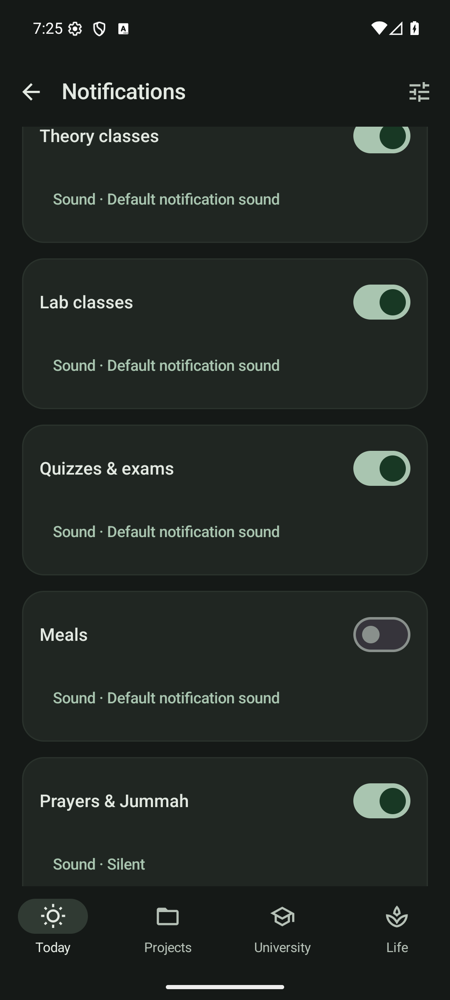

# Notification categories and sounds

Open **Settings → Notification categories & sounds**. Turn on the main **Reminders** switch and allow Android notification permission when asked. Then enable only the categories you want:

- Daily briefing
- Theory classes and lab classes, independently
- Quizzes & exams
- Meals
- Prayers & Jummah
- Study sessions
- Projects & capstone, including project-based labs
- Assignments
- Prework & lab reports
- Routines
- Travel

The individual switches remain editable when the main switch is off. Switching a category off removes its scheduled alerts and its displayed notifications. Turning everything off preserves the individual choices for later.

## Sound

Tap a category's **Sound** button and choose:

- **Silent**: notification-tray entry, without sound or vibration.
- **Default notification sound**: the phone's notification tone.
- **Choose ringtone…**: Android's ringtone picker, including its available notification, alarm and ringtone choices and previews. Cancelling the picker retains the previous selection.

Each category has independent sound settings. The link **Android settings for this category** opens its current system channel, where Android also lets you control visibility and interruptions. Android channel overrides, global volume, notification permission and Do Not Disturb remain in effect. Stillday does not raise notification volume. The optional Fajr wake alarm has separate controls under Day planning and is unaffected by these reminder switches.

Sound choices are included in JSON and Drive backups. Phone-specific ringtone URIs may not exist on another device; an unavailable tone falls back to the default notification sound. Select a replacement in the picker if needed.

## When reminders happen

Classes/labs and assessments use **Settings → Reminder timing → Minutes before classes / exams**. Assignment/project deadlines and lab submissions use the deadline lead time. Lab submissions also have a deadline-time alert; report reminders wait until the experiment ends.

Meals, routines, travel and generated study/project work notify at their scheduled start. Meal skips receive no meal alert. Prayer alerts start five minutes before congregation, matching the mosque travel window; Friday Jummah uses its configured time. Project work pauses during exam focus while deadline warnings remain available.

Changing a schedule, submitting lab work, completing a routine, or disabling a category refreshes alarms. Delivery checks the current planner again so old alarms cannot announce cancelled or moved work. Tapping a reminder opens its relevant page, including experiment details and selected study/project slots.

Reminders use Android inexact alarms and refresh periodically and after reboot/time changes/app updates. Doze and battery policies can delay or group alerts; these notifications are not exact wake alarms.

Implementation follows Android's [notification channel rules](https://developer.android.com/develop/ui/compose/notifications/channels) and [system ringtone picker](https://developer.android.com/reference/android/media/RingtoneManager). Sound configurations use stable per-category channels because Android does not allow an existing channel's auditory settings to be replaced programmatically.

