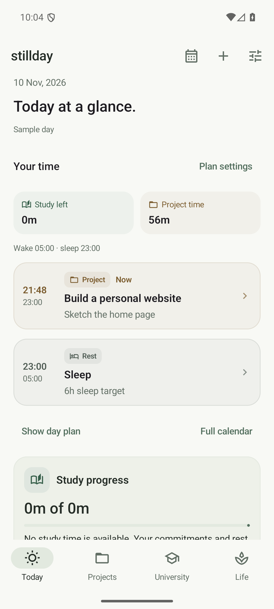
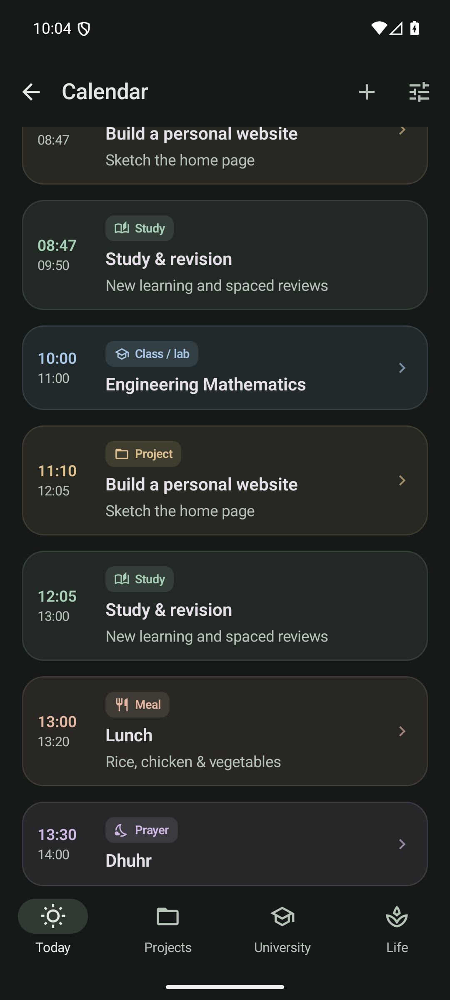
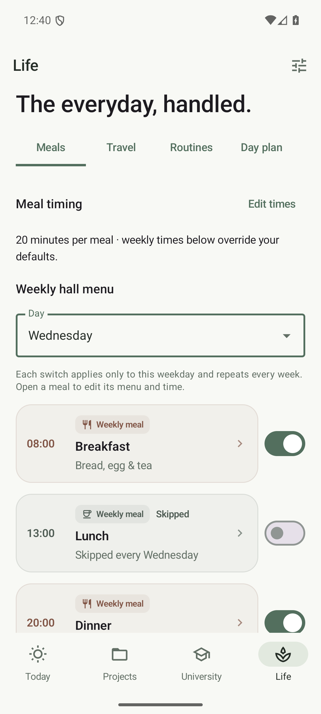

# Stillday visual system

Goal: identify the next activity, its type and its time without reading paragraphs. Keep the existing quiet character across Pixel 7 layouts, larger text and all light/dark themes.

  
  
  

All preview records and prayer times are synthetic, entered into the real app for screenshots. They are examples rather than a local prayer timetable.

Use one shared visual vocabulary throughout Today, Calendar, University, Projects, Life and the agenda widget:

- Study: muted sage, book icon.
- Prayer: muted violet, moon icon.
- Classes and labs: muted blue, school/science icons.
- Projects: warm amber, project icon.
- Meals: soft clay, dining icon.
- Deadlines: muted rust, flag icon.
- Everyday activities and rest: neutral surfaces, routine/coffee icons.

Category colors are functional identifiers requested by the user. They extend the design-first skill's single-accent example; surfaces stay neutral, saturated fills are avoided, and colors are always paired with icons and visible labels.

Hierarchy: time or status first, activity title second, one short supporting line third. Use a compact summary above the next activities. Today previews upcoming cards immediately, with an option to expand the complete remaining plan. Keep Calendar as the full-day view and avoid duplicate lists of the same classes on Today.

Cards share leading category icons, subtle tinted surfaces, rounded corners and strong titles. Use badges for category, duration and state; progress bars for completion. Keep tap targets at least 48 dp, allow text wrapping, and maintain readable text contrast in every theme. Display dates as 10 Aug, 2026.

Weekly meals: choose the weekday, then use each meal's Eat/Skip switch. Wednesday lunch can recur as skipped while other days keep their meals. Dated overrides, including Eat as usual, take priority. Skipped meals remain visibly marked in the menu and reserve no time in the day planner.

Validation: core tests for meal precedence, persistence/migration tests, UI interaction tests, palette contrast checks and real 1080 × 2400 Pixel 7 screenshots in Paper and Charcoal, plus larger text.
