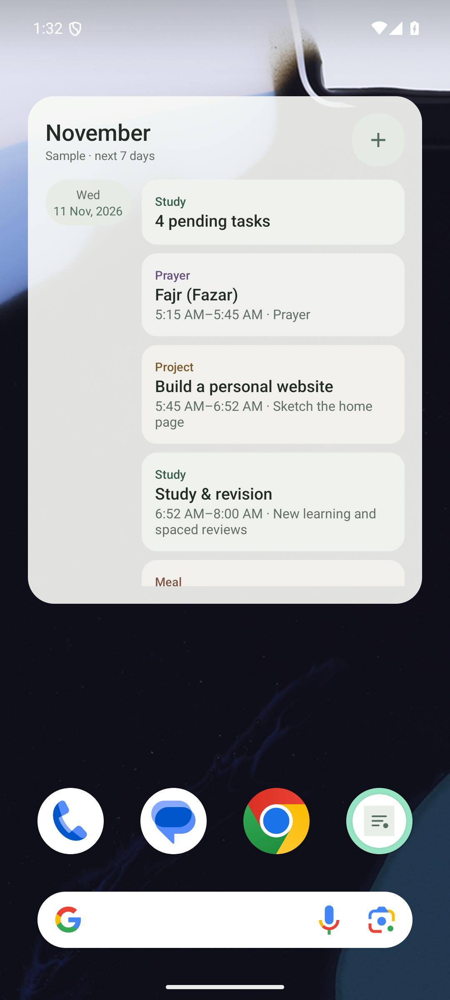
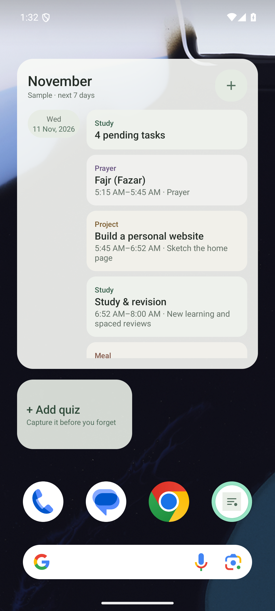
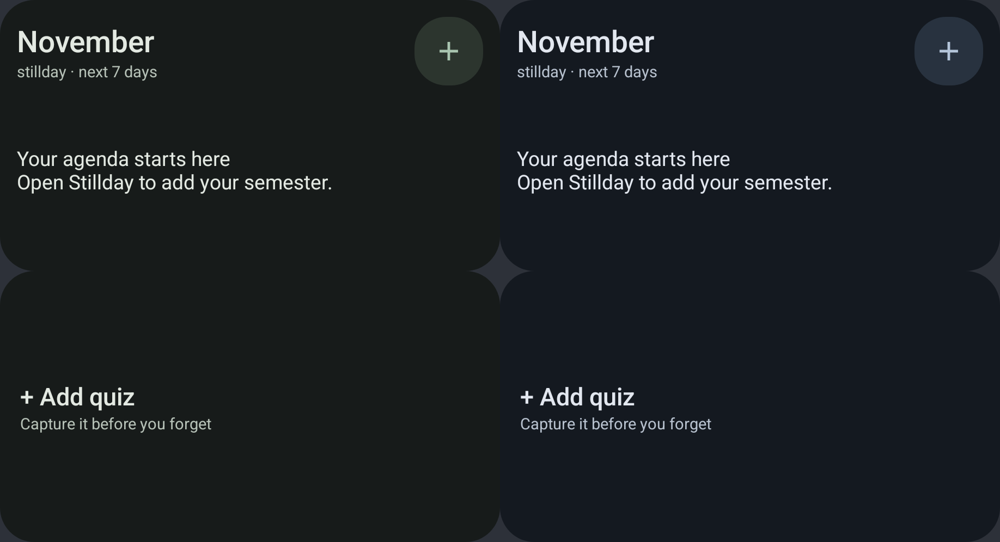

# Stillday home-screen widgets

Add it from **Settings → Home-screen widgets → Add agenda widget**, then accept the launcher's placement prompt. You can also long-press an empty area of the home screen, choose **Widgets → Stillday → Stillday agenda**, and drag it into place. The existing Add Quiz shortcut remains available separately.

The agenda groups today and the next six days by date. It shows upcoming/ongoing classes and labs, quizzes and exams, assignment and active-project deadlines, scheduled routines, and travel departures. Today's pending-task count follows the same project/focus rules as Today, including pending lab prework and reports. Tap the count to open Today, an event to open its details, the month to open Calendar, or **+** to add a quiz.

Cancelled classes and classes suspended during exams are omitted. Individual reschedules use their actual new date and time. Completed assignments/routines and paused projects are omitted. Provisional exams are labeled until the routine is entered. Deadlines remain visible during exam focus.

The widget follows Paper, Warm Sand, Charcoal, Midnight, or the system theme selected in the app. Its rounded background is 90% opaque, with lightly translucent cards and muted category accents. This lets the wallpaper show through without sacrificing legibility. It does not blur or read your wallpaper. No additional permission or network access is needed.

Drag the widget's resize handles to change its size; scroll inside the agenda to see later entries. It supports a minimum layout of 250 × 180 dp. Long names wrap to two lines. The widget includes the next 40 entries; **Open full calendar** appears at the end when more are available. The complete schedule stays in the app. This limit includes generated study, project, meal, prayer and sleep entries.

Version 1.0.11 gives both widgets native Android RemoteViews providers. Add Quiz has an immediately usable native layout, and the agenda loads scrolling rows through Android's collection service. Widget display no longer depends on Glance composition sessions or widget WorkManager jobs. Database loading runs off the widget service's main thread to avoid startup hangs. Existing provider names are retained so placed widgets keep their IDs. If your launcher retains an old error view after updating, remove and re-add both widgets once.

The 40-entry limit and 160-code-point text limits protect against a separate busy-agenda transport failure. Rows are delivered individually, keeping the main widget update small even with a large schedule.

Saved changes, completed tasks, imports, resets and theme changes request an immediate widget refresh. Android also requests a refresh roughly every 30 minutes while the widget is placed. Boot/date/time/timezone changes request a refresh; Android's background scheduling may delay it. Dates use your configured university timezone, and time labels follow the phone's 12/24-hour setting.

Demo screenshots are captured from the real Pixel 7 emulator launcher using synthetic persisted records, not image mockups. See [TEST_REPORT.md](TEST_REPORT.md) for verification results.

## Dark-theme correction in 1.0.14

Both agenda and Add Quiz follow the selected app theme, including Charcoal, Midnight and System dark mode. The old shortcut had fixed light colors. The agenda also used translucent color filters over white shapes, which blended white into the tint instead of making the view itself translucent.

The widgets now apply opaque theme colors to opaque drawable masks and set actual image opacity separately: approximately 90% for the outer surface, 92% for activity cards and 88% for date chips. Text stays opaque. Updated masks are reapplied to existing views, and Add Quiz uses a new layout ID so already-placed shortcuts are reinflated without retaining their old light root background.

On Android 12 and later, paired day/night RemoteViews colors let cached views and agenda rows adapt when the launcher reapplies them after a system theme change. App configuration changes request a provider refresh, including on older Android versions. Explicit app themes retain their chosen palette regardless of the phone's mode. Native initial layouts and picker previews also have night resources.

Pixel tests cover both widgets in every app theme and both system modes, cached System views switching light/dark/light, cached agenda rows/date chips, and initial night layouts. Real-host checks verify the existing shortcut layout is replaced, tapping still opens Add Quiz, and changing the app theme refreshes that same placed shortcut.

Below are native widget views rendered on the Pixel 7 emulator over a neutral background: Charcoal on the left, Midnight on the right. The agenda uses its empty/setup state; row palettes are verified separately. This comparison is not a launcher screenshot.

References: [RemoteViews day/night colors](https://developer.android.com/reference/android/widget/RemoteViews#setColorInt(int,%20java.lang.String,%20int,%20int)), [ImageView color filtering and image alpha](https://developer.android.com/reference/android/widget/ImageView).
